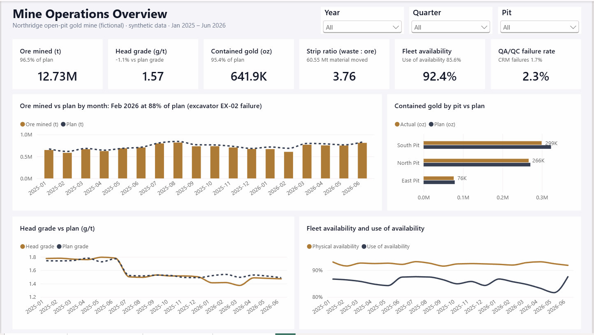
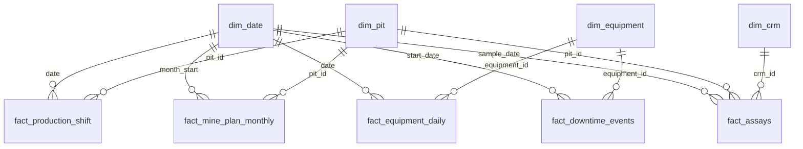
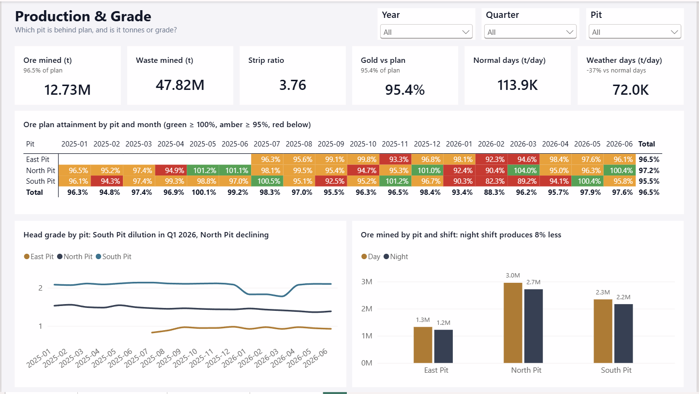
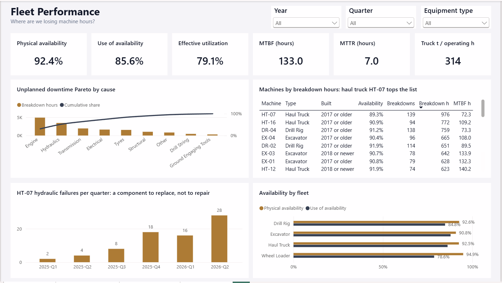
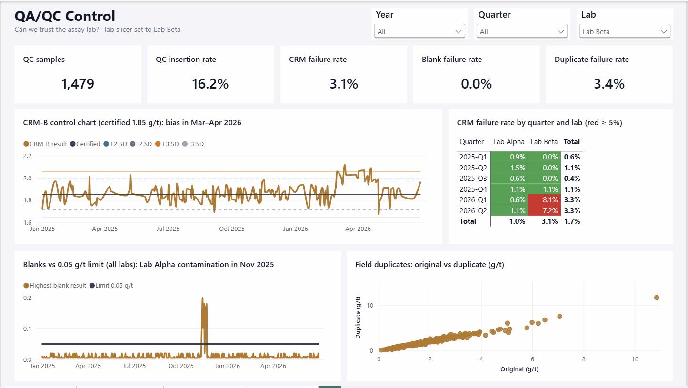

# Mining Operations Dashboard (Power BI)

A four-page Power BI report for an open-pit gold mine that answers the questions a mine manager asks every morning:

- Are we mining what the plan says, and at the planned grade?
- Is the fleet available, and what is breaking down?
- Can we trust the assay lab this week?

> **Data:** fully synthetic but realistic: 18 months (Jan 2025 – Jun 2026), 3 pits, 31 machines and 29,600 grade-control samples.
> It was generated with [`scripts/generate_data.py`](scripts/generate_data.py) (fixed seed), so the dashboard can be shared publicly.
> No company data is used.



---

## Business questions and the page that answers them

| Page | Question | Main visuals |
|---|---|---|
| **1. Mine Overview** | Are we on plan this month / year? | KPI cards with plan variance, ore actual vs plan by month, gold ounces by pit |
| **2. Production & Grade** | Which pit is behind, and is it tonnes or grade? | Pit × month matrix with conditional formatting, grade vs plan trend, day vs night shift, weather impact |
| **3. Fleet Performance** | Where are we losing machine hours? | Availability / utilization by fleet and unit, downtime Pareto, MTBF / MTTR, fuel per tonne |
| **4. QA/QC Control** | Are the assay results reliable? | CRM control chart with ±2 SD / ±3 SD limits, blank chart with 0.05 g/t limit, duplicate scatter, failure rate by lab and month |

## Key findings in the data

1. **Ore plan attainment was 96.5%** over 18 months (12.73 Mt mined vs 13.20 Mt planned). Contained gold reached 95.4% of plan (641.9 koz).
2. **February 2026 was the worst month (88.3% of plan).** The drill-down shows a 118-hour engine failure on excavator EX-02. Excavator availability dropped to 86.8% that month, against 90.8% on average, so loading capacity, not trucks, became the bottleneck.
3. **South Pit grade fell 15% below plan in Q1 2026** (1.81 vs 2.14 g/t). At the same time ore tonnes were 13% short and the strip ratio rose, the typical signature of dilution and ore loss. Together they cost about **12,800 oz (−26%)** against plan.
4. **North Pit grade is trending down**, from 1.53 g/t (Q1 2025) to 1.38 g/t (Q2 2026). It fell below plan for the first time in Q2 2026, so the high-grade zone is being depleted.
5. **Haul truck HT-07 has the most unplanned downtime of the fleet**: 976 h, about 2× the median truck. Its hydraulic failures went from 6 to 26 to 44 per half-year, which points to a component replacement rather than more repairs.
6. **Lab Beta showed a systematic bias in March–April 2026.** 23% of its CRM results fell outside ±3 SD, against about 1–3% in other months. All CRMs read high, so this is a calibration issue, not random error.
7. **Lab Alpha had a contamination event in November 2025**: 29% of blanks were above the 0.05 g/t limit.
8. **Weather days (39 in the period) cut daily material moved by 37%**, and night shift produces 8% less ore than day shift.

## Data model

Star schema with a single date table. The monthly plan is joined at month level and **prorated to days in DAX**, so plan vs actual works at any date range.



| Table | Grain | Rows |
|---|---|---|
| `fact_production_shift` | date × shift × pit | 2,914 |
| `fact_mine_plan_monthly` | month × pit | 48 |
| `fact_equipment_daily` | date × machine (hours, loads, tonnes, fuel) | 16,078 |
| `fact_downtime_events` | one row per breakdown or PM service | 3,567 |
| `fact_assays` | one row per sample (primary, CRM, blank, duplicate) | 29,614 |
| `dim_pit`, `dim_equipment`, `dim_crm` | lookups | 3 / 31 / 3 |
| `dim_date` | DAX calculated table | 546 |

## KPI definitions

| KPI | Formula |
|---|---|
| Strip ratio | waste t ÷ ore t |
| Head grade | Σ(ore t × grade) ÷ Σ ore t (tonnage-weighted, never a simple average) |
| Contained gold | Σ(ore t × grade) ÷ 31.1035 g/oz |
| Physical availability (PA) | (scheduled h − planned down − unplanned down) ÷ scheduled h |
| Use of availability (UoA) | operating h ÷ available h |
| Effective utilization (EU) | operating h ÷ scheduled h = PA × UoA |
| MTBF / MTTR | operating h ÷ breakdowns / breakdown hours ÷ breakdowns |
| CRM result | Pass within ±2 SD of the certified value, Warning 2–3 SD, Fail beyond 3 SD |
| Blank result | Fail above 0.05 g/t (5 × detection limit) |
| Duplicate result | Fail when \|a − b\| ÷ mean(a, b) > 20% (pairs with mean ≥ 0.1 g/t) |

All measures are in [`powerbi/measures.md`](powerbi/measures.md), and the Power Query steps are in [`powerbi/power_query.m`](powerbi/power_query.m).

## Techniques used

- **Power Query:** typed import with a fixed locale, cleaning of `<0.01` lab results (replaced by half the detection limit), and merging the duplicate pairs.
- **DAX:** prorating a monthly plan to any date range, weighted averages, time intelligence (YoY), a Pareto (cumulative %) of downtime causes, dynamic control limits, and calculated QC status columns.
- **Design:** one KPI row per page, every number shown against plan or last year, conditional formatting, and drill-through from month to day.

## All pages

| Production & Grade | Fleet Performance | QA/QC Control |
|---|---|---|
|  |  |  |

## Repository

The report is saved as a **Power BI Project (`.pbip`)**: the model and every page are plain text, so changes are visible in Git.

```
Mining Operations Dashboard.pbip              open this in Power BI Desktop
Mining Operations Dashboard.SemanticModel/    model: tables, relationships, 75 DAX measures
Mining Operations Dashboard.Report/           4 report pages and the theme
data/                                         CSV files (the dataset)
scripts/generate_data.py                      rebuilds the dataset
powerbi/                                      measures.md, power_query.m, theme.json (readable copies)
screenshots/                                  report pages
```

## Open it

1. Open `Mining Operations Dashboard.pbip` in Power BI Desktop (2024 or later).
2. Set the data folder: **Transform data → Edit parameters → `DataFolder`** = the full path of `data\` on your PC.
3. Click **Refresh**. The data loads in a few seconds.
4. To get a single file, use **File → Save as → Power BI file (.pbix)**.

Optional: `python scripts/generate_data.py` regenerates `data/` (Python 3.9+, no extra packages).

---
Built by Avazbek S. as a portfolio project. Power BI · DAX · Power Query · Data Modeling
